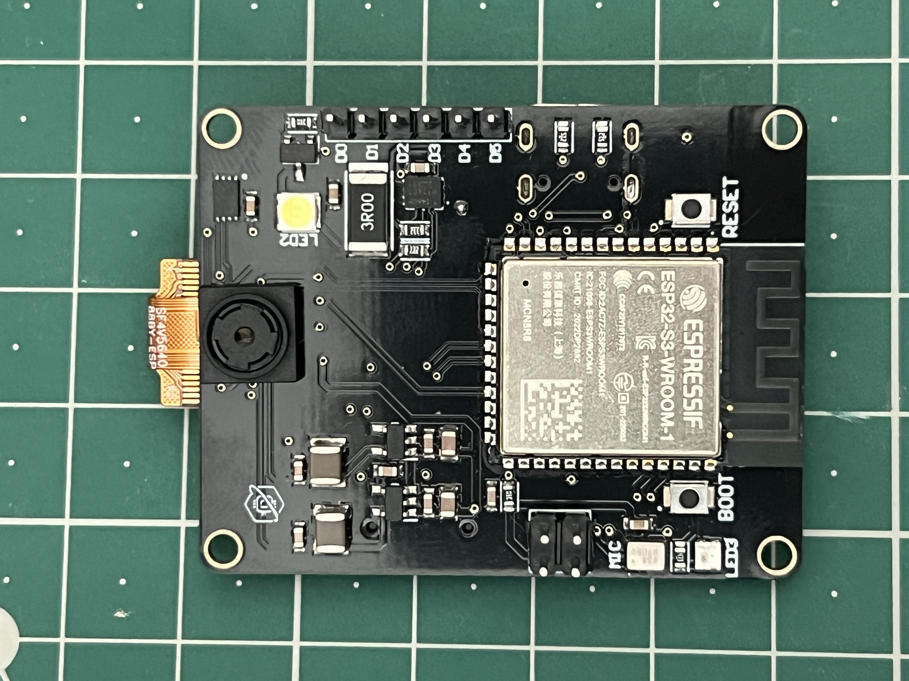
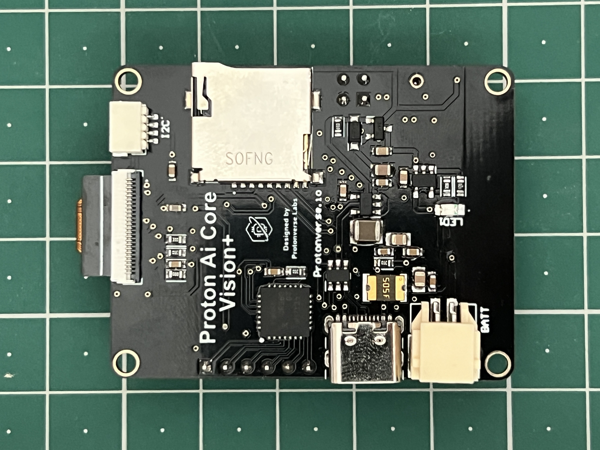

**Proton AI Core Vision+ is heading toward launch.** Leave your email on the official pre-launch page to be the first to know when it goes live: **[Get notified at launch →](https://prelaunch.com/projects/proton-ai-core-proton-ai-core-the-future-of-diy-ai-integration)**

---

# Proton AI Core Vision+

**An ESP32-S3 camera development board with onboard IMU, secure element, I/O expander, microphone, and microSD — built by [Protonverse Labs](https://github.com/protonverse-labs).**




Proton AI Core Vision+ is a functional hardware prototype: physical boards exist, have been tested, and run the working firmware in this repository. It is not yet in mass production. See [Project Status](docs/project-status.md) for exactly what has and hasn't been verified.

**[Quick Start](#quick-start)** · **[Documentation](docs/)** · **[Hardware Overview](docs/hardware-overview.md)** · **[Camera Guide](docs/camera.md)** · **[Firmware](firmware/)**

---

## See It in Action

Real board photos are available now (front and back below). A recorded hardware demo (boot, camera stream, serial output) is in progress — see [docs/DEMO_RECORDING_CHECKLIST.md](docs/DEMO_RECORDING_CHECKLIST.md) for exactly what's being captured and why. This section will be updated with a demo GIF/video once that recording is complete.

| Top view | Bottom view |
|---|---|
|  |  |

## 30-Second Overview

| Category | Proton AI Core Vision+ |
|---|---|
| MCU | ESP32-S3-WROOM-1-N16R8 (dual-core, 16MB flash, 8MB PSRAM) |
| Camera | OV5640, 5MP sensor, 24-pin FPC interface |
| Connectivity | Wi-Fi (ESP32-S3 built-in) |
| USB | USB-C, native USB (CDC serial) |
| Other onboard sensors | IMU (ICM-42670-P), I2S microphone (ICS-43434), secure element (ATECC608B) |
| Firmware | Arduino (ESP32 Arduino core) — open source, included in this repo |
| Project status | Functional hardware prototype — hardware tested, firmware and camera operational |

Full details: [docs/hardware-overview.md](docs/hardware-overview.md)

## Key Features

- **ESP32-S3-WROOM-1-N16R8** — dual-core MCU, 16MB flash, 8MB OPI PSRAM
- **OV5640 5MP camera** on a 24-pin FPC connector, driven by the included firmware (JPEG capture + MJPEG streaming)
- **ICM-42670-P IMU** and **ATECC608B secure element**, both on the shared I2C bus
- **PCA9685 16-channel PWM/GPIO expander** broken out to a header, for servos, motors, or extra LEDs
- **ICS-43434 I2S MEMS microphone** and **microSD** storage (SPI)
- **Addressable RGB status LED** (WS2812B) and a **1W LED** output
- **USB-C** (native USB / CDC serial for programming and monitoring) and **Li-Po battery input** with onboard charge management
- Runs today on **open, working Arduino firmware** with a serial command interface and a built-in HTTP server for JPEG capture and MJPEG streaming

## Why Proton AI Core Vision+?

Most ESP32-S3 camera boards give you the sensor and little else. Proton AI Core Vision+ puts a tested camera, an IMU, a hardware secure element, a 16-channel PWM/GPIO expander, an I2S microphone, microSD storage, Li-Po charging, and status LEDs on one board — so a camera-based prototype starts from working hardware instead of a breadboard of separately wired modules.

It's a reasonable starting point if you're building:
- a camera-enabled embedded or robotics prototype that also needs motion sensing or servo/PWM control
- a project that wants a hardware-backed secure element without adding a second board
- anything where you'd otherwise be wiring an ESP32-S3 dev board, a camera breakout, an IMU breakout, and an I/O expander together by hand

It does **not** currently include on-device AI acceleration or a neural processing unit — see [Project Status](docs/project-status.md) for what is and isn't verified.

## Quick Start

**Prerequisites**
- [Arduino IDE](https://www.arduino.cc/en/software) 2.x
- ESP32 board package (Espressif Systems), installed via Boards Manager
- Adafruit NeoPixel library, installed via Library Manager
- A USB-C cable and a Proton AI Core Vision+ board

**1. Clone the repository**
```bash
git clone https://github.com/Protonverse-Labs/proton-ai-core-vision-plus.git
cd proton-ai-core-vision-plus
```

**2. Install required tools** — in Arduino IDE: Boards Manager → search `esp32` (by Espressif Systems) → Install. Library Manager → search `Adafruit NeoPixel` → Install.

**3. Connect Proton AI Core Vision+** to your computer with a USB-C cable.

**4. Configure the board** — Tools menu in Arduino IDE:
| Setting | Value |
|---|---|
| Board | ESP32S3 Dev Module |
| USB CDC On Boot | Enabled |
| PSRAM | OPI PSRAM / Enabled |
| Flash Size | 16MB |
| Partition Scheme | Huge APP |
| Port | (select the board's serial port) |

**5. Open the firmware**
```
firmware/proton-ai-core-vision-plus/Proton_AI_CoreVision_Firmware_V20.ino
```

**6. (Optional) Set Wi-Fi credentials** — if you want camera streaming over Wi-Fi, edit `WIFI_SSID` and `WIFI_PASS` near the top of the file.

**7. Build and flash** — click Upload in Arduino IDE.

**8. Open the Serial Monitor** at `115200` baud. You should see the boot banner and command list.

**9. Test the camera** — type `cam_init`, then `cam_capture` in the Serial Monitor.

Full walkthrough with expected serial output: [docs/getting-started.md](docs/getting-started.md)

## Hardware Overview

Proton AI Core Vision+ combines an ESP32-S3-WROOM-1-N16R8 module with an OV5640 camera, an IMU, a secure element, an I/O expander, a microphone, microSD storage, status LEDs, USB-C, and Li-Po battery charging on a single board.

- [Hardware Overview](docs/hardware-overview.md) — verified components and subsystems
- [Pinout](docs/pinout.md) — GPIO assignments, taken directly from firmware and cross-checked against the schematic
- [Schematic (PDF)](hardware/Schematic.pdf) — full approved schematic

This repository does not include PCB layout/manufacturing source files, Gerbers, or the production BOM — see [hardware/README.md](hardware/README.md) for why.

## Camera

The OV5640 sensor is driven by the included firmware over an 8-bit parallel + SCCB (I2C) interface. Camera init, single-frame JPEG capture, and MJPEG streaming over Wi-Fi have been tested on physical hardware. The firmware exposes four selectable resolution presets from QVGA up to XGA for both capture and streaming.

Full guide, including tested commands and known limitations: [docs/camera.md](docs/camera.md)

## Example Projects

Small, focused sketches extracted from the working firmware — start here instead of the full firmware if you only need one subsystem:

| Example | What it does |
|---|---|
| [01_camera_capture](examples/01_camera_capture/) | Initialize the camera and capture a single JPEG frame over Serial |
| [02_wifi_camera_stream](examples/02_wifi_camera_stream/) | Connect to Wi-Fi and serve an MJPEG camera stream over HTTP |
| [03_status_led](examples/03_status_led/) | Drive the onboard RGB status LED and 1W LED over Serial commands |

## Documentation

| Guide | Description |
|---|---|
| [Getting Started](docs/getting-started.md) | Full setup walkthrough, first boot, first camera test |
| [Hardware Overview](docs/hardware-overview.md) | Verified components and subsystems |
| [Pinout](docs/pinout.md) | GPIO assignments and bus map |
| [Camera Guide](docs/camera.md) | Camera init, capture, streaming, resolutions, troubleshooting |
| [Firmware Guide](docs/firmware.md) | Firmware architecture, build settings, serial command reference |
| [Flashing Guide](docs/flashing.md) | Build and flash instructions in detail |
| [Troubleshooting](docs/troubleshooting.md) | Known failure modes and fixes |
| [FAQ](docs/faq.md) | Common questions |
| [Project Status](docs/project-status.md) | What is verified today, transparently |
| [Roadmap](docs/roadmap.md) | Available now / in progress / planned |
| [Demo Recording Checklist](docs/DEMO_RECORDING_CHECKLIST.md) | What the next hardware demo recording will show |

## Firmware

The current firmware (`firmware/proton-ai-core-vision-plus/`) is a single Arduino sketch built on the ESP32 Arduino core. It exposes a serial command interface (camera control, I2C device tests, LED control, SD/mic tests, Wi-Fi) and a small onboard HTTP server for JPEG capture and MJPEG streaming.

Architecture and full command reference: [docs/firmware.md](docs/firmware.md)

## Project Status

Proton AI Core Vision+ is a **functional hardware prototype**, not a shipping product. Physical boards have been built and tested; the firmware and camera are operational. Mass production has not launched, and a Crowd Supply application is in preparation.

Full, transparent status: [docs/project-status.md](docs/project-status.md)

## Roadmap

See [docs/roadmap.md](docs/roadmap.md) for what's available now, in progress, and planned. The roadmap reflects real, current goals — no speculative feature list or fixed dates that haven't been committed to.

## Community & Contributing

Issues and pull requests are welcome — bug reports, documentation fixes, new examples, and firmware improvements all help. See [CONTRIBUTING.md](CONTRIBUTING.md) for guidelines and [CODE_OF_CONDUCT.md](CODE_OF_CONDUCT.md) for how we expect people to treat each other here.

Found a security issue? See [SECURITY.md](SECURITY.md) instead of opening a public issue.

## Licensing

A firmware license has not been finalized yet; this will be added as a `LICENSE` file once decided (see [CHANGELOG.md](CHANGELOG.md) for updates). This repository provides firmware, examples, and hardware **documentation** for developing with Proton AI Core Vision+ — it is not a fully open-source hardware release. PCB layout/manufacturing source files, Gerbers, and the production BOM are intentionally not included; see [hardware/README.md](hardware/README.md).

---

If Proton AI Core Vision+ is useful or interesting to you, star the repository to follow its development.
